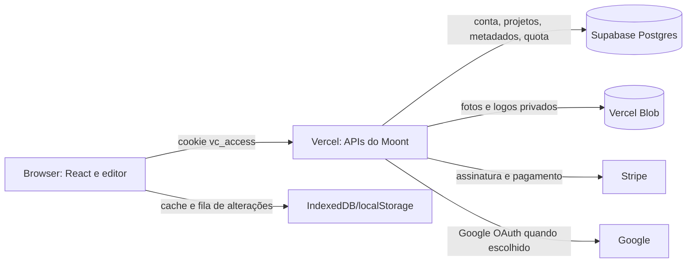

# Arquitetura do Moont para crescer por conta

Estado do código em 15/10/2026. Este documento descreve o que está implementado no repositório e separa a ativação em produção dos passos que ainda são necessários para atender milhares de usuários. A existência de uma tabela ou rota não prova que uma flag já foi ligada no deploy.

## Visão geral

- **Interface:** Vite + React. `ViralCarrossel.jsx` ainda concentra boa parte do editor e do estado; a biblioteca, a fila e os clientes de API estão em `src/utils/`.
- **Servidor:** funções em `api/`, executadas na Vercel. O navegador não acessa o Postgres nem o Blob privado diretamente. As rotas de projetos e metadados exigem o cookie assinado `vc_access` e uma assinatura ativa. Em produção, a checagem de acesso não usa o cache curto em memória.
- **Banco:** Supabase Postgres, schema privado `moont`, acessado pelo servidor com `pg` e pooler de transações. A conexão usa TLS com verificação de certificado; cada instância abre um pool de até duas conexões. As tabelas não integram o schema público do PostgREST.
- **Mídia:** Vercel Blob privado mantém os bytes de fotos e logos. O banco guarda referências, não data URLs grandes. A API de assets ainda é `/api/library-sync`.
- **Cobrança:** Stripe continua sendo a fonte para customer, plano, período e estado da assinatura. O Postgres guarda a identidade própria da conta e a quota operacional de imagens quando as flags correspondentes estão ativas.
- **Navegador:** IndexedDB guarda mídia/cache e uma fila durável por projeto/conta; `localStorage` continua como cache de interface. Nenhum dos dois deve decidir sozinho quais projetos existem na conta.

## Modelo de dados

As migrações estão em `db/migrations/001_account_library.sql` a `005_request_limits.sql`.

| Tabela | Função | Chave e proteção principal |
| --- | --- | --- |
| `moont.accounts` | Conta interna do Moont, com UUID e época de revogação de sessão | `id` UUID; e-mail não é chave única |
| `moont.account_stripe_customers` | Vínculo verificado entre conta e customer Stripe | `stripe_customer_id` único; `account_id` único |
| `moont.account_identities` | Login por senha ou Google | `(provider, provider_subject)` único; não une clientes pelo e-mail |
| `moont.account_password_credentials` | Hash e salt `scrypt` herdados ou atualizados | Uma credencial por conta; sem senha em claro |
| `moont.account_libraries` | Revisão, contagem, ordem e metadados globais da biblioteca | `owner_id`; `meta_revision` independente da revisão de projetos |
| `moont.account_projects` | Um JSON de projeto por linha, versão e exclusão persistente | `(owner_id, project_id)`; índice para lista paginada; `deleted_at` impede retorno de projeto excluído |
| `moont.image_quota_periods` | Uso por conta e ciclo de assinatura | `(owner_id, period_start_sec)` |
| `moont.image_quota_operations` | Reserva, confirmação ou devolução de um crédito por geração | `(owner_id, period_start_sec, operation_id)` |
| `moont.rate_limit_buckets` | Limite de pedidos partilhado entre funções | Hash de IP/rota e janela; limpeza limitada de janelas vencidas |
| `moont.ocr_daily_quotas` e `moont.ocr_daily_operations` | Teto diário de OCR por conta e reembolso idempotente | `(owner_id, quota_day)` e identificador de operação |

**Distinção atual de IDs:** a identidade já possui UUID próprio, mas a biblioteca, os assets e a quota ainda usam preferencialmente o `customerId` Stripe como `owner_id`, preservando as chaves legadas. O UUID ainda não substitui essa chave em todos os dados. O cliente local também usa aliases de owner; uma futura troca para UUID exige migração explícita desses aliases e dos caminhos do Blob. Dois customers com o mesmo e-mail não devem ser mesclados automaticamente.

## O que acontece em cada ação

1. **Entrar e abrir a biblioteca.** A API valida `vc_access` e a assinatura Stripe. Com `ACCOUNT_IDENTITY_BACKEND=postgres`, vincula o customer Stripe verificado à conta interna e valida a época da sessão no banco. Com `LIBRARY_SYNC_BACKEND=postgres`, o primeiro acesso a uma biblioteca ainda ausente no banco lê o manifesto legado do Blob antes de criar linhas; se essa leitura falhar, o erro não vira biblioteca vazia. A interface V2 envia primeiro a fila local pendente, consulta `/api/projects` e os metadados globais, e restaura o estado React a partir da nuvem. Fotos ausentes não removem os textos nem o projeto.
2. **Salvar.** O cliente empacota somente o projeto ativo, envia as fotos necessárias ao Blob e grava o projeto via `PUT /api/projects` com a versão observada. O banco bloqueia a linha da biblioteca durante a transação e responde `409` se outro dispositivo mudou a versão. A interface só pode anunciar confirmação depois da resposta do servidor. Uma alteração ainda não enviada fica na fila IndexedDB, identificada por conta e projeto; a fila só é removida depois da confirmação da versão.
3. **Sincronizar.** A interface tenta a fila pendente, salva projetos e metadados alterados, lê a biblioteca da conta e aplica o snapshot ao React. `GET /api/projects` entrega resumos paginados e `GET /api/projects?id=...` entrega um projeto completo; durante a transição, o boot e o Sync ainda consultam o manifesto completo via `/api/library-sync?full=1` para montar a lista local.
4. **Excluir.** `DELETE /api/projects` exige a versão conhecida, grava um tombstone e reduz a contagem na mesma transação. O manifesto legado sintetizado pelo banco inclui o ID em `deletedIds`, impedindo que um push antigo o ressuscite. No backend Postgres, o endpoint legado de push não aceita `replace` como varredura de toda a biblioteca.
5. **Marcas, pastas e perfil.** `/api/account-library-meta` grava esses dados separadamente, com `baseRevision`. Um salvamento de projeto não substitui essas preferências. Imagens de marca são enviadas ao Blob antes do metadado que as referencia.
6. **Gerar imagem.** Com `IMAGE_QUOTA_BACKEND=postgres`, o primeiro uso do ciclo importa o maior contador legado persistente disponível (Upstash/Stripe); com `UPSTASH_DISABLED=1`, importa somente o Stripe. Erro de leitura da fonte habilitada não cria saldo zero. Cada operação reserva um crédito em transação, confirma no sucesso e devolve em falha. A tela de Uso lê `used`, `limit` e `remaining` dessa quota; o limite continua ligado ao plano Stripe.
7. **Sair.** O cliente tenta proteger a edição atual antes de limpar dados locais. Na V2, não envia um manifesto legado no logout, pois isso poderia desfazer exclusões. A revogação do cookie e da época de sessão ocorre no servidor quando o backend de identidade está ativo.
8. **OCR e proteção de rotas.** `OCR_QUOTA_BACKEND=postgres` guarda o contador diário por conta, com reserva e reembolso por operação. `RATE_LIMIT_BACKEND=postgres` usa contadores por IP/rota/janela, partilhados entre funções. Se o banco falhar, o OCR recusa novas leituras; o limitador de pedidos volta por 30 segundos ao limite local. Este último modo é apenas uma degradação de disponibilidade, não uma proteção distribuída.

## Migração e ativação

As rotas V2 e a interface são separadas pelas flags `LIBRARY_SYNC_BACKEND=postgres`, `ACCOUNT_IDENTITY_BACKEND=postgres`, `IMAGE_QUOTA_BACKEND=postgres`, `OCR_QUOTA_BACKEND=postgres`, `RATE_LIMIT_BACKEND=postgres` (servidor) e `VITE_PROJECTS_V2=true` (build da interface). A rota de projetos e a de metadados recusam requisições enquanto o backend Postgres da biblioteca estiver desligado. A leitura inicial do Blob ocorre **uma vez por owner**; por isso, atualizar o Blob depois que uma linha vazia foi criada no Postgres não atualiza aquela conta automaticamente.

`UPSTASH_DISABLED=1` desliga a consulta às credenciais Redis legadas sem apagar esses segredos da Vercel. A migração inicial dos projetos usa o manifesto no Blob; a quota importa do Stripe e falha se ele estiver indisponível; novas partilhas usam Blob privado sem ponteiro Redis e expiram após 30 dias pela data da última atualização. Antes de ativar, verificar que não há manifestos ou partilhas necessários armazenados **somente** no Redis. Links de partilha existentes apenas ali ficam inacessíveis com a flag; esta opção não migra tais documentos. A ausência da flag preserva o comportamento anterior.

Ordem segura de virada: preservar/exportar a biblioteca de teste e verificar imagens; aplicar migrações e testar conexão; confirmar que o Blob da conta contém a edição mais recente; importar e conferir os projetos no banco; publicar código e flags da interface, biblioteca, identidade e quota no mesmo deploy; validar em dois navegadores e acompanhar erros e contagens. Não remover os manifestos e assets legados na mesma virada. Em uma volta atrás, primeiro suspender gravações e reconciliar as alterações criadas no Postgres para o formato legado; desligar flags sem essa cópia ocultaria projetos recentes. Rollback de código é diferente de rollback de dados.

Uma cópia JSON local e o manifesto Blob legado ajudam na recuperação inicial, mas não substituem um plano de backup do Postgres. Antes de abrir cadastros, definir e testar restauração de banco, retenção, controle de acesso às credenciais e cópias dos assets privados. Não afirmar que backup automático ou recuperação pontual estão ativos sem verificar a configuração do projeto Supabase.

## Escala: ganhos e limites honestos

O Postgres elimina o manifesto único como unidade de escrita: projetos têm versões e exclusões independentes; a lista da API usa índice e paginação sem transportar slides. Isso permite milhares de contas e projetos com menos contenção entre usuários. A quota transacional evita saldos diferentes entre instâncias serverless. A API limita cada projeto a 2 MiB de JSON, os metadados globais a 512 KiB e uma página da lista a 100 itens; fotos ficam fora dessas linhas.

Ainda há gargalos antes de prometer uma biblioteca com milhares de projetos **em uma única conta**:

- O boot e o Sync V2 ainda baixam um manifesto completo e materializam a biblioteca inteira no React. Converter essas telas para consumir a lista paginada e buscar o detalhe só ao abrir é a próxima mudança prioritária.
- A preparação e a sincronização manual ainda percorrem todos os projetos locais; uploads grandes de fotos passam por chamadas à função Vercel e podem exigir retomada. Evitar importar tudo de novo quando só um projeto mudou.
- `account_libraries` é bloqueada para atualizar revisão/contagem a cada PUT/DELETE; isso é simples e consistente, mas pode virar ponto de contenção em colaboração intensa dentro da mesma conta. Medir antes de repartir o contador.
- Não há edição colaborativa em tempo real nem merge de duas edições do mesmo projeto. Um `409` de edição salva a versão local como cópia separada; uma exclusão de versão alterada fica para revisão. Equipes grandes ainda precisarão de uma interface de comparação e resolução mais rica.
- A quota possui operações `reserved`; ainda falta uma rotina auditada para identificar reservas antigas que ficaram sem confirmação após timeout, sem devolver crédito de uma geração efetivamente concluída.
- A autorização consulta Stripe durante os acessos protegidos em produção. Monitorar latência e falhas da dependência; uma futura projeção local do estado de assinatura requer webhooks confiáveis, reconciliação e política clara para atraso na revogação.
- As funções mantêm pools pequenos por instância, mas a quantidade de instâncias pode crescer. Acompanhar conexões ativas, saturação do pooler, tempo de query e custo de egress/armazenamento de imagens.
- O limite distribuído por IP grava uma linha no Postgres a cada pedido. Isto remove a dependência de Redis avariado, mas não é a solução final se o tráfego crescer muito: monitorar o Micro e migrar esta proteção para Redis funcional ou WAF gerido antes de aumentar substancialmente o volume de requisições.

## Operação e indicadores

O código possui mensagens de erro e alguns logs/telemetria, mas não há um painel operacional completo implementado para esta migração. Instrumentar, por rota e sem dados sensíveis nos logs:

- taxa de sucesso e latência p50/p95 de login, lista, detalhe, PUT, DELETE, upload e download de asset;
- `409`, `503`, tamanho e idade da fila IndexedDB, tempo até salvar na nuvem;
- diferença entre `project_count` do banco e número exibido; quantidade de tombstones e fotos ausentes;
- reservas de imagem antigas, consumo por período e divergência entre contador, plano e Stripe;
- importações legadas concluídas/falhas, conexões Postgres em uso, tempo de query, volume Blob e falhas de restauração;
- restauração testada de backup e teste sintético em dois navegadores com uma conta de teste.

Critério de lançamento: criar, editar e excluir um projeto numa conta de teste; conferir a mesma lista e os mesmos textos após refresh, logout/login e em outro navegador; deixar uma foto indisponível e confirmar que a lista permanece; simular conflito de versão e indisponibilidade do banco sem mensagem falsa de sucesso.
