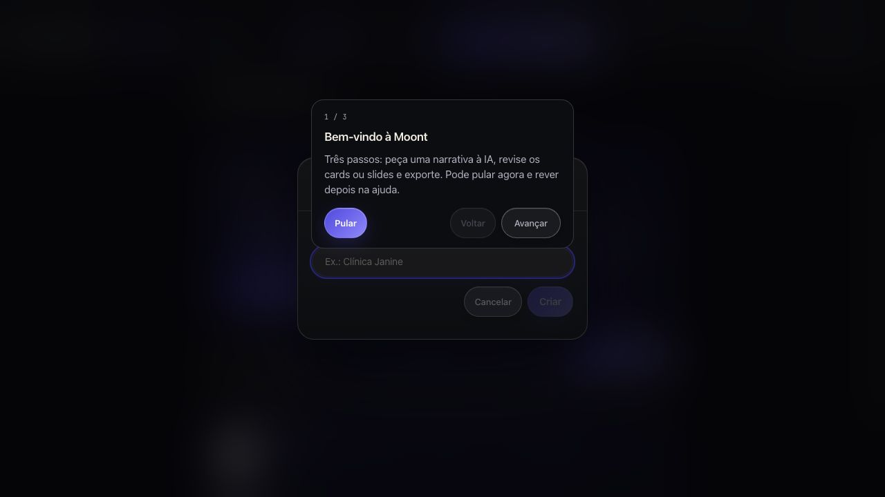
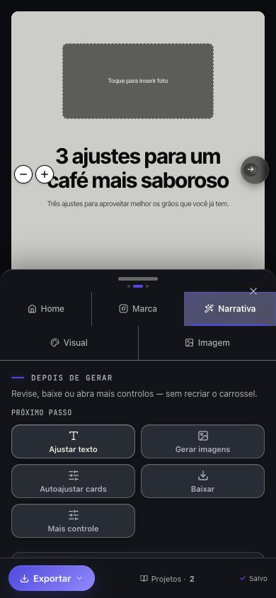

# Moont — revisão da primeira experiência de um social media

Revisão em 20/10/2026 · versão local `59ef95d` · desktop 1280 × 720 e editor em viewport móvel 390 × 844.

**Diagnóstico:** a Moont já reúne recursos úteis para produzir uma peça. O primeiro uso, porém, ainda exige que a pessoa aprenda a organização interna do editor antes de trabalhar com segurança. Para um social media, o caminho principal deveria ser **cliente → objetivo → conteúdo → revisão → entrega**.

## Como a revisão foi feita

- Página inicial, escolha de plano e acesso observados no site público em produção.
- Editor percorrido pela interface, com uma conta vazia simulada e o mesmo build local da versão examinada. Cenário: criar seis cards educativos para a marca fictícia Café Aurora, revisar o título, aplicar um padrão visual e exportar.
- Autenticação, armazenamento remoto e respostas de IA foram simulados no ambiente local. A revisão avalia a interface e o fluxo; não mede qualidade da IA, tempo real de geração, cobrança ou sincronização entre aparelhos.
- O PDF foi efetivamente baixado e inspecionado: seis páginas, proporção 4:5, título e nome do arquivo coerentes com o projeto. O espaço de foto vazio do editor não aparece como aviso no PDF.
- Nenhum projeto real foi editado. Não houve envio a clientes, criação de convites, compra de plano ou alteração do produto nesta revisão.

É uma inspeção orientada por uma persona, não uma pesquisa com usuários reais. As prioridades abaixo são julgamentos de usabilidade, não estimativas de conversão.

## O que já ajuda

1. **A promessa da página inicial combina com a rotina.** “A pauta chegou. O prazo já está correndo” descreve uma pressão reconhecível, e a explicação conecta briefing, narrativa, visual e revisão.
2. **O pedido em linguagem natural é um bom ponto de partida.** O campo central torna possível começar sem configurar todo o editor.
3. **Texto, imagem e padrão visual podem ser trabalhados separadamente.** Editar o título no cenário de teste atualizou o card, e aplicar um padrão manteve o conteúdo.
4. **Existe uma sequência de próximos passos depois da criação.** Ajustar texto, gerar imagens e baixar são ações úteis; precisam ganhar mais foco e ocupar menos espaço.
5. **A exportação funcionou no cenário examinado.** O PDF trouxe os seis cards com o nome do projeto. O menu também diferencia imagem individual, pacote ZIP e PDF.
6. **A interface avisa que não publica no Instagram.** Essa distinção é importante e deve ser preservada, inclusive ao usar estados como “Agendado”.

## Achados prioritários

P1 = atrapalha uma tarefa central ou a confiança no trabalho. P2 = aumenta esforço, dúvida ou necessidade de ajuda. “Decisão de produto” identifica uma recomendação que depende do posicionamento comercial, não um defeito técnico.

| Prioridade | Evidência observada | Efeito para quem está começando | Mudança recomendada |
|---|---|---|---|
| **P1 · defeito** | O tour abriu por cima da janela que pede o nome do projeto. Foi preciso pular o tour para continuar. | Duas tarefas disputam a mesma tela e a orientação interrompe a criação. | Exibir orientação somente depois de concluir a ação atual; nunca sobre outro diálogo. Preferir dicas no próprio contexto. |
| **P1 · edição** | No modo recomendado “Criar rápido”, a aba Texto fica escondida. Em Visual, a ajuda diz: “A cor do texto fica na aba Texto”. | A pessoa recebe uma instrução que não consegue seguir na interface disponível. | Disponibilizar fonte, tamanho, cor e alinhamento em todos os modos. Deixar apenas controles especializados no modo avançado. |
| **P1 · mobile** | Ao tocar em “Ajustar texto”, o painel abre a seção correta, mas o campo continua abaixo da área visível; a tela mostra principalmente os botões de próximos passos. | É preciso procurar e rolar depois de já ter escolhido editar. | Abrir o campo do texto selecionado, levar o foco até ele e recolher controles secundários. |
| **P1 · contexto** | O cabeçalho móvel apresenta logo, ações e formatos, sem mostrar o nome do projeto ou da marca na vista principal. | Um profissional com vários clientes perde uma confirmação importante antes de editar ou exportar. | Manter cliente e nome da peça visíveis, mesmo em uma linha compacta. |
| **P1 · confiança** | Aparecem “Salvo neste navegador”, recomendação de backup “para não perder o trabalho”, mensagens de nuvem e um botão “Sync na nuvem”. | A pessoa não sabe qual confirmação significa que o trabalho está disponível em outro aparelho. | Mostrar um único estado baseado no salvamento real: “Salvando”, “Salvo na conta às…”, “Sem conexão — alterações pendentes” ou “Falha ao sincronizar”. Backup como ação adicional, sem contradizer o estado. |
| **P1 · decisão de produto** | “Criar meu primeiro projeto” abre diretamente a escolha de plano, com Criador de R$ 97/mês selecionado. O cadastro por senha é encontrado dentro de “Entrar com senha”. | O convite parece iniciar a criação, mas exige uma decisão comercial antes de experimentar o produto. | Se a assinatura continuar obrigatória, explicitar isso no botão e oferecer uma demonstração útil. Se houver experiência inicial, levar a um exemplo editável antes da cobrança. Dar acesso direto a “Criar conta”. |
| **P2 · clientes** | A conta vazia já mostra “Carrossel” como projeto em edição. Ao criar outra peça, já existem dois projetos. A marca começa como “Padrão” e “Gerir marcas” oferece salvar a identidade atual. | Projeto, marca e conteúdo ficam difíceis de distinguir. A primeira biblioteca parece conter trabalho que o usuário não criou. | Começar com biblioteca realmente vazia ou exemplo identificado. Pedir cliente/marca junto ao nome da peça; usar exemplo de nome de conteúdo, não só o nome de uma clínica. |
| **P2 · orientação** | As boas-vindas explicam profundidade, modo de interface, modo narrativo e tom de voz. O editor oferece Assistente IA, criação central, criação lateral, templates e pesquisa. | O usuário precisa aprender a taxonomia e escolher um caminho antes de ver valor. | Um início principal: “O que vamos criar?”. Objetivo, formato e marca primeiro; modos e controles avançados depois. |
| **P2 · legenda** | A geração guarda uma legenda geral, mas a área de revisão apresenta “Legenda do card 01” vazia e explica que copiar junta as legendas dos cards. O código confirma que copiar pode usar a legenda geral como alternativa. | Um carrossel é um único post para o social media; ele pode achar que a legenda desapareceu ou não saber qual texto será copiado. | Apresentar “Legenda da publicação” preenchida e revisável. Separar notas por card, quando necessárias. Mostrar exatamente a legenda que será copiada. |
| **P2 · entrega ao cliente** | O caminho exposto de colaboração é “Criar link para a equipe”, com conta Moont e ações “Publicar/Puxar alterações”. Os estados de projeto visíveis são Rascunho, Pronto, Agendado e Publicado. | Compartilhar para um cliente aprovar se confunde com convidar alguém para editar e sincronizar. | Separar “Enviar para aprovação” de “Convidar para editar”. Projetar leitura, comentários e estados “Em aprovação”, “Ajustes solicitados” e “Aprovado”. Não tratar o convite atual como se já fosse esse fluxo. |
| **P2 · entrega mobile** | O botão principal do rodapé é “PNG” para o card atual. O pacote completo está no menu de exportação dentro do painel de edição. | É fácil entregar só uma imagem quando a intenção é baixar o carrossel inteiro. | Usar “Exportar” como entrada consistente. Oferecer primeiro “Todos os 6 cards”; depois “Somente este card”. |
| **P2 · alcance das mudanças** | Escolher um padrão visual modifica o conjunto, embora um card esteja selecionado. A interface explica que não altera texto, mas o alcance visual não tem a mesma evidência. | O usuário pode entender a seleção como “editar este card” e mudar a identidade de toda a peça sem prever. | Indicar claramente “Este card” ou “Todos os cards” perto da ação. Mostrar confirmação de resultado com opção de desfazer, sem criar um diálogo para cada clique. |

## Evidências visuais

### A orientação interrompe a criação

[Captura completa](06-tour-sobre-criacao.png). O tour está à frente do formulário de nome, com dois conjuntos de ações competindo.

### O primeiro editor pede que a pessoa descubra a organização do produto

[Primeiro editor](07-editor-primeira-peca.png), [boas-vindas](04-boas-vindas.png) e [cadastro da marca](08-marcas.png). O pedido central é um bom ponto de partida; a marca está em outro caminho e o projeto de exemplo não é identificado como exemplo.

### A edição móvel não chega diretamente ao campo

[Captura do painel depois de “Ajustar texto”](14-mobile-editar-texto.png). O painel abre, mas os campos ficam depois dos próximos passos e das seções intermediárias.

### A exportação preservou a peça de teste

[Menu de exportação](12-exportacao.png) e [primeira página renderizada do PDF](15-pdf-primeiro-card.png). O arquivo `carrossel-cafe-aurora-dicas-de-preparo.pdf` tem seis páginas. Isso confirma este cenário de texto e padrão visual, não todos os tipos de imagem ou efeitos disponíveis.

## Ocorrência separada: aba antiga após atualização

Uma aba que já estava aberta falhou ao entrar no editor, buscando um arquivo antigo (`ViralCarrossel-B5CjTYRe.js`). A tela antiga orientava apagar chaves de armazenamento. [Evidência](02-aba-antiga-erro.png).

Uma visita nova abriu normalmente. O código atual de entrada já contém tratamento de atualização e recarga, sem essa orientação antiga. Portanto, **não classifiquei essa ocorrência isolada como uma regressão reproduzida da versão atual**. Ela mostra o risco de continuidade para abas antigas e merece um teste específico de troca de versão. Nenhum dado do navegador foi apagado.

## Fluxo recomendado para o primeiro projeto

| Etapa | O que a pessoa vê | O que precisa decidir |
|---|---|---|
| 1. Criar conteúdo | “Para qual cliente?” e “O que vamos criar?” | Marca existente ou nova; carrossel, post, stories ou apresentação. |
| 2. Dar direção | Campo de briefing com exemplos e anexos opcionais | Objetivo, público, assunto e ação esperada. A marca já preenche tom, logo e cores. |
| 3. Gerar primeira versão | Resumo do pedido, número de cards e indicação clara de uso de imagens | Só texto ou texto e imagens, com consumo informado quando aplicável. |
| 4. Revisar | Card selecionado com Texto, Imagem e Visual acessíveis | Editar, reordenar, ajustar esta peça ou aplicar ao conjunto. |
| 5. Entregar | Legenda da publicação, revisão do conjunto e exportação | Todos os cards, PDF para revisão ou encaminhamento para aprovação, quando implementado. |

O modo avançado continua disponível, mas não precisa ser uma decisão obrigatória das boas-vindas. A troca de cliente, o nome do projeto e o estado de salvamento acompanham toda a jornada.

## Ordem sugerida de trabalho

**Primeiro: confiança e continuidade.** Corrigir sobreposição do tour; tornar salvamento inequívoco; exibir cliente/projeto no celular; manter testes de abas abertas durante atualização.

**Depois: primeira peça.** Disponibilizar os controles básicos de texto em Criar rápido; abrir o campo ao tocar em editar; retirar o projeto vazio automático da biblioteca ou rotulá-lo como exemplo; reduzir entradas duplicadas de geração.

**Em seguida: rotina profissional.** Unificar legenda da publicação; explicitar alcance de estilos; facilitar exportação em lote no celular; desenhar aprovação separada de edição colaborativa.

**Decisão comercial independente:** alinhar o convite da página inicial à assinatura ou à experiência demonstrativa escolhida. Evitar prometer uma experiência gratuita que não existe.

## Critérios para uma próxima validação

- Nova conta começa com estado vazio compreensível e uma ação principal.
- Nenhum tour aparece sobre um diálogo ou interrompe o preenchimento de um campo.
- Fonte, tamanho, alinhamento e cor são encontráveis sem trocar de modo.
- “Ajustar texto” torna o campo selecionado visível tanto no desktop quanto no celular.
- Cliente, peça e situação do salvamento ficam identificáveis durante a edição.
- A legenda exibida para revisão é a mesma que será copiada.
- O usuário distingue editar em equipe, solicitar aprovação e publicar no Instagram.
- O pacote exportado contém a quantidade esperada e usa o nome da peça.

Validar com social medias reais, sem explicar os nomes internos: entregar o mesmo briefing e pedir criação, revisão e exportação. Registrar onde pedem ajuda, voltam de tela, interpretam o alcance de uma ação incorretamente ou não sabem se o trabalho foi salvo. Não atribuir ganho de conversão antes de medir.

## Referências para implementação

- Tour: `ViralCarrossel.jsx`, efeito iniciado em torno da linha 3186; bloqueia boas-vindas, mas não a janela de nome observada.
- Controles por modo: `src/components/SidebarContent.jsx`, linhas 152–164; Texto exige nível Diretor. A ajuda em Visual remete à aba na linha 3081.
- Boas-vindas: `src/components/ModesIntroModal.jsx`, explicação inicial perto da linha 124.
- Marcas: `src/components/BrandsModal.jsx`, ajuda e aplicação de identidade perto da linha 148.
- Legenda: `src/components/SidebarContent.jsx`, revisão perto da linha 4039 e cópia geral perto da linha 418.
- Salvamento: `src/components/SidebarContent.jsx`, rótulo fixo perto da linha 4144.
- Equipe: `src/components/panels/TeamSharePanel.jsx`, convite e operações Publicar/Puxar.
- Recuperação após atualização: `src/main.jsx`.
